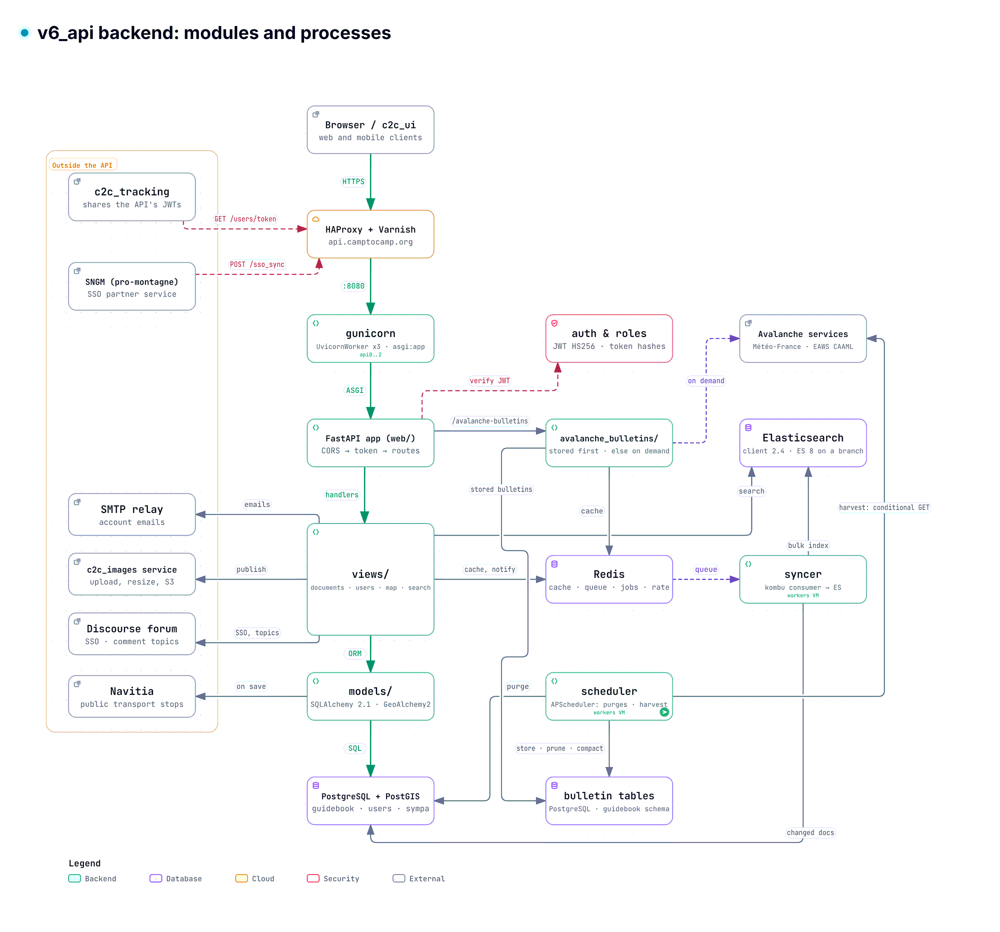
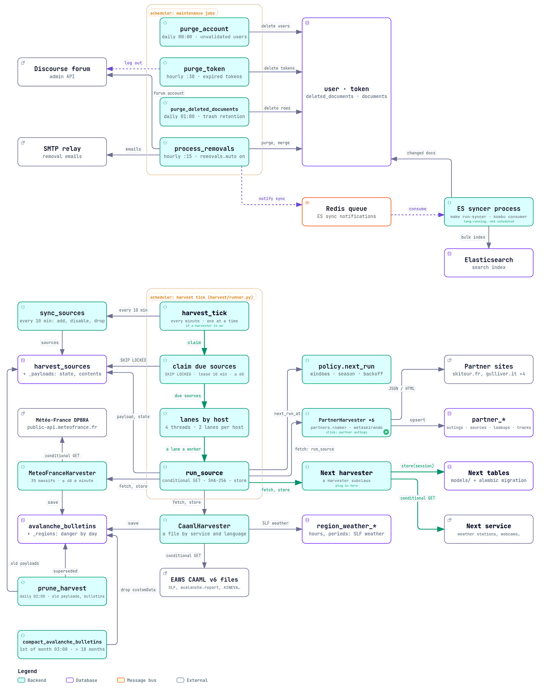
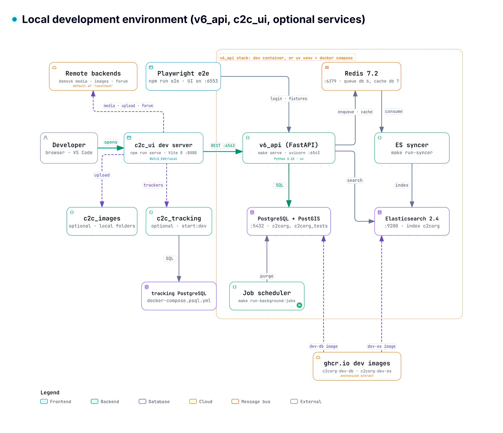
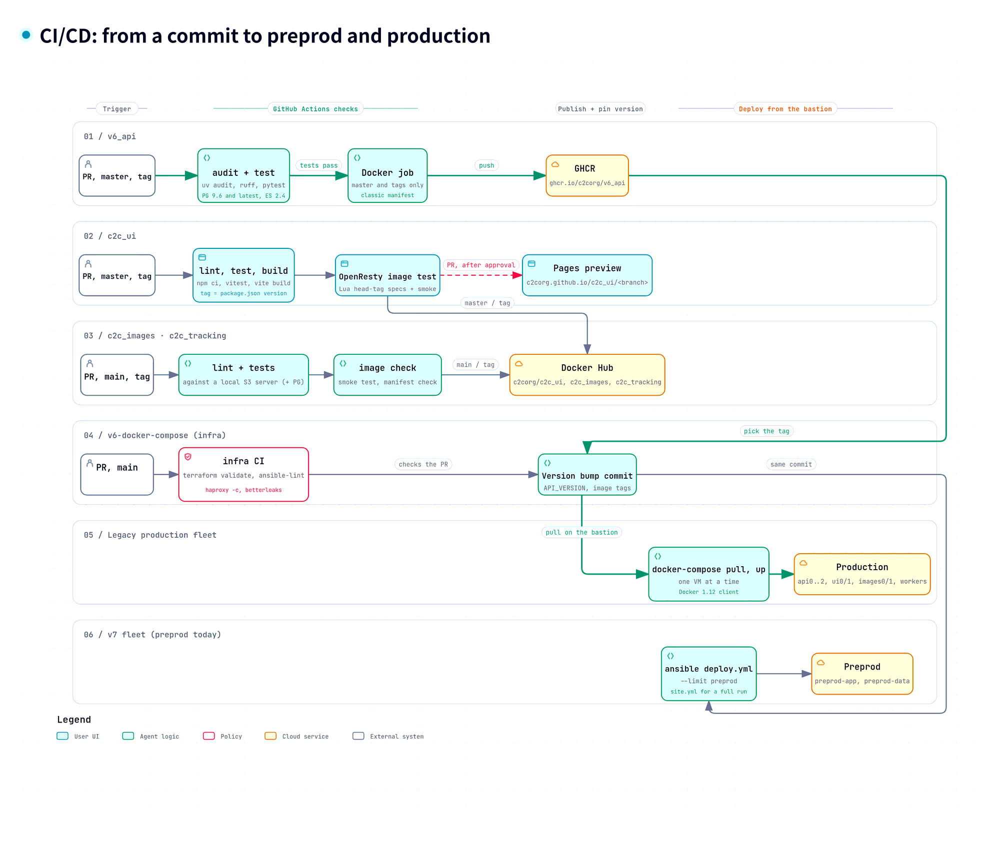

# [camptocamp.org](https://www.camptocamp.org) API

[](https://github.com/c2corg/v6_api/blob/master/LICENSE)


[](https://app.codacy.com/gh/c2corg/v6_api/dashboard)
[](https://snyk.io/test/github/c2corg/v6_api)

## Architecture

### Backend (v6_api)

[](https://c2corg.github.io/v6_api/architecture/backend.html)

### Background jobs and harvesters

[](https://c2corg.github.io/v6_api/architecture/batch.html)

### Local development

[](https://c2corg.github.io/v6_api/architecture/local-dev.html)

### CI/CD

[](https://c2corg.github.io/v6_api/architecture/ci-cd.html)


Interactive versions and more: <https://c2corg.github.io/v6_api/>.

## Getting started: Dev Container (recommended)

Python, PostgreSQL/PostGIS, Elasticsearch and Redis all run in the containers defined in
[`.devcontainer/`](.devcontainer/README.md): nothing but a container engine is installed on your
machine. A [manual setup](HOWTO-MANUAL-DEV.md), with Python on the host, also exists but is not
recommended.

### Prerequisites

- Docker (Docker Desktop, or Docker Engine with Compose v2), or Podman (see [Podman](#podman)).
- Optional: [VS Code](https://code.visualstudio.com/) with the
  [Dev Containers extension](https://marketplace.visualstudio.com/items?itemName=ms-vscode-remote.remote-containers).

On Apple Silicon, the published database and Elasticsearch images run under amd64 emulation
(the Python container is native): it works, the index rebuild is just slower.

### With VS Code

1. `git clone https://github.com/c2corg/v6_api && code v6_api`
2. Click **Reopen in Container** (or command palette → `Dev Containers: Reopen in Container`).
3. Wait for `.devcontainer/setup.sh` (the `postCreateCommand`) to finish: a few minutes the first time,
   up to ~10 minutes if the search index has to be rebuilt under emulation.
4. In a VS Code terminal (it runs in the app container): `make serve`, then open
   <http://localhost:6543/health>.

### Without VS Code

The same stack from any terminal. Compose does not run the `postCreateCommand`, so run the setup
yourself. A shell alias keeps the commands short:

```sh
git clone https://github.com/c2corg/v6_api && cd v6_api
alias dc='docker compose -p v6-api-dev -f .devcontainer/docker-compose.yml'   # or podman compose

dc up -d --build --wait                     # build the app image, start and wait for the services
dc exec app bash .devcontainer/setup.sh     # once, and again after a rebuild
dc exec app make serve                      # foreground; then http://localhost:6543/health
dc exec app bash                            # a shell in the app container, for the commands below
dc stop                                     # stop, keeping the data
```

### What `setup.sh` does

It installs the locked Python dependencies (in `/opt/venv`, outside the workspace) and the git
pre-commit hook, generates the `*.ini` files, migrates the dev database to the alembic revision of
your checkout, creates the test database, and keeps the prebuilt search index if it matches the
indexing code of your checkout (otherwise rebuilds it). It is idempotent: re-run it after pulling
or switching branches; it keeps your data.

### Where the commands run

Unless stated otherwise, the `make`, `pytest`, `alembic`… commands of this README run **inside the
app container** (a VS Code terminal, or `dc exec app bash`). Do not run `make bootstrap` or
`make start` there: they belong to the manual setup.

| Service       | Hostname (from the app container) | From the host                                 |
|---------------|-----------------------------------|-----------------------------------------------|
| API           | `localhost:6543`                  | `127.0.0.1:6543` (once `make serve` runs)     |
| PostgreSQL    | `postgresql:5432`                 | forwarded by VS Code only                     |
| Elasticsearch | `elasticsearch:9200`              | forwarded by VS Code only                     |
| Redis         | `redis:6379`                      | forwarded by VS Code only                     |

### Rebuilding and resetting

- Dependencies or `.devcontainer/Dockerfile` changed: `Dev Containers: Rebuild Container` in VS Code,
  or `dc up -d --build --wait` then `dc exec app bash .devcontainer/setup.sh`.
- Fresh database and index (**deletes your local data**): `dc down -v && dc pull`, then start and run
  the setup again. With VS Code the Compose project is named after the folder: find its
  `…_postgres_data` and `…_es_data` volumes with `docker volume ls`.

### Claude Code on the web / restricted sandboxes

See [docs/claude-code-cloud.md](docs/claude-code-cloud.md) (`scripts/sandbox-up.sh`).

### Podman

Use a Compose provider supporting `up --wait` (Docker Compose v2 or podman-compose 1.6+; check with
`podman compose version`, choose one with `PODMAN_COMPOSE_PROVIDER`).

- macOS: `podman machine start` (`podman machine init` first if there is no machine).
- Linux, rootless: `systemctl --user enable --now podman.socket`.
- VS Code: set **Dev Containers: Docker Path** to `podman` and **Dev Containers: Docker Compose
  Path** to your provider, e.g. `podman-compose`.
- Without VS Code: `alias dc='podman compose -p v6-api-dev -f .devcontainer/docker-compose.yml'`.

## Configuration and development data

- Do not edit the generated `*.ini` files. Put your overrides in `config/env.local` (git-ignored)
  and run `make load-env`. In the dev container, `config/env.devcontainer` is applied last, so the
  service hostnames always point to the containers.
- The dev database is a lightweight anonymized extract of production (about 45,000 documents), and
  Elasticsearch comes with its index already built: see
  [`scripts/dev-database`](scripts/dev-database/README.md).
- Accounts: `moderator`, `user`, `blocked`, `unvalidated`, password `c2c` for all.
- The UI dev servers (`npm run serve` in c2c_ui, `http://localhost:8080` or any other port of
  `localhost` / `127.0.0.1`) are allowed by the CORS configuration of the local API: select
  `http://localhost:6543` as their backend.
- There is no Discourse: `config/env.dev` sets `discourse_enabled="false"`. Logging in, registering
  and editing a profile work; creating the comments topic of a document answers 503. To work on the
  forum, run a Discourse and set `discourse_enabled="true"`, `discourse_url`, its key and secret in
  `config/env.local`. The tests mock the forum and do not need it.
- Dependencies: edit `pyproject.toml`, run `uv lock`, commit both files, then re-run the setup.

For the "Mobilité douce" (public transport) features, see [SMART-ORIGIN-README.md](SMART-ORIGIN-README.md).

## Development

### Running the API and the workers

```sh
make serve                 # the API, with auto-reload, on port 6543
make run-syncer            # Elasticsearch syncer: needed to see your edits in the search
make run-background-jobs   # scheduled jobs
```

Each one stays in the foreground: use one terminal per command. Check <http://localhost:6543/health>.

### Code layout

The API is a [FastAPI](https://fastapi.tiangolo.com/) application, served by uvicorn: `c2corg_api/asgi.py` reads the `.ini` file named by `C2C_API_CONFIG` (`production.ini` by default). In production, gunicorn runs uvicorn workers (`gunicorn -k uvicorn_worker.UvicornWorker c2corg_api.asgi:app`).

`c2corg_api.config` reads the settings of the `.ini` files, for the application and the scripts. The tests drive the application through a WSGI bridge (`c2corg_api:main`).

- `c2corg_api/app.py`: the FastAPI application, its middlewares (CORS, token validation, unexpected errors) and the answers to unknown routes and methods.
- `c2corg_api/web/`: the routes, one module per resource (`documents.py`, `users.py`, `navitia.py`…). They are thin: each one runs a function of `views/` through `web/handlers.py` (the order of the checks, the commit of the writes); `web/request.py` gives the views the request they expect (`validated`, `errors`, `matchdict`…), `web/checks.py` checks the content type, the permission and the origin, and `web/answers.py` turns what the views return or raise into the answer.
- `c2corg_api/views/`: the view functions and their validators (`views/validation.py`). `@write(...)` in `views/resource.py` declares the validators, permission and content type of a write view; the read routes declare theirs in `web/`. The route checks the rate limiting (writes only), then the content type, the permission and the validators, and calls the view.
- `c2corg_api/schemas/`: the Pydantic schemas of the request bodies; `c2corg_api/models/`: the SQLAlchemy models.
- `c2corg_api/security/`: tokens (`roles.py`), rate limiting, Discourse client; `c2corg_api/httpexceptions.py`: the HTTP errors the views raise.
- `c2corg_api/scripts/`: the Elasticsearch syncer, the job scheduler and the maintenance scripts; they read the `.ini` file with `c2corg_api/config.py`.
- `c2corg_api/harvest/` and `c2corg_api/avalanche_bulletins/`: the scheduler harvests the avalanche bulletins into PostgreSQL, the API reads them from there: see [docs/harvest.md](docs/harvest.md) and the
  [background jobs diagram](https://c2corg.github.io/v6_api/architecture/batch.html).

### Running tests

```sh
make test                                        # pytest -n 4
pytest c2corg_api/tests/models/test_book.py      # one file
```

- With `-n`, each [pytest-xdist](https://pytest-xdist.readthedocs.io/) worker uses its own database (`<test database>_gw0`, `_gw1`...), Elasticsearch index and Redis names, created on the first run. The test database user needs the right to create databases.
- Write new tests as plain functions asking for the fixtures of `c2corg_api/tests/conftest.py` (`client`, `session`, `user_ids`, `tokens`, `settings`...) and the helpers of `c2corg_api.tests` (`auth_headers`, `send_json`...); the shared document scenarios are in `c2corg_api/tests/views/scenarios.py`. See #2610.
- A warning fails the tests (`filterwarnings` in `pyproject.toml`): fix its cause rather than ignoring it. The only exceptions are the warnings of the Elasticsearch 2 client, still shown until the move to Elasticsearch 8.

#### API contract tests

`c2corg_api/tests/contract/` checks what the clients of the API rely on, so that a change of framework or library cannot change it unnoticed:

- `routes.txt` lists every route with its methods and permission. After adding, removing or changing a route, regenerate it with `python -m c2corg_api.tests.contract.inventory`.
- Each contract test sends a request and compares the status, the headers clients rely on (CORS, `Cache-Control`, `ETag`…) and the shape of the JSON body (keys and value types) with a snapshot in `snapshots/`. After an intended change of the API, rewrite the snapshots with `CONTRACT_UPDATE=1 pytest c2corg_api/tests/contract` and review their diff.
- Every route has a contract test (marked with `@contract(...)`); `pending.txt`, empty, would list a route without one. A new route needs its contract test.

#### Load test

`scripts/loadtest.py` replays a mix of read requests (documents, listings, search, history) with a few threads and prints throughput and latency percentiles per kind of request. It compares two versions of the API on the same machine and data; run each version twice to see the noise:

```sh
python scripts/loadtest.py http://localhost:6543 --threads 8 --duration 60
```

For load tests of a staging environment, use the Locust scenarios in [`c2corg_api/scripts/loadtests/`](c2corg_api/scripts/loadtests/README.md).

### Linting

```sh
make format   # ruff format + ruff check --fix (VS Code also formats on save in the dev container)
make lint     # ruff check + ruff format --check, as in CI
make audit    # known vulnerabilities of the locked dependencies (exceptions: AUDIT_IGNORE in the Makefile)
```

A git pre-commit hook runs ruff before each commit (installed by the setup). It uses the Python of the
app container: commit from the dev container (VS Code does), or install `pre-commit` on the host too
(`uv tool install pre-commit` or `brew install pre-commit`) to commit from a host terminal.

### Other

- Flush the Redis cache: `make flush-redis`.
- Rebuild the whole index without interrupting the search (production): `reindex_es production.ini`.
  A new timestamped index is built next to the live one, then `elasticsearch.index` is switched to it
  as an alias, atomically. The first time, if it is still a real index, run once with
  `--replace-index` (short search gap). `--keep-old` keeps the previous index instead of deleting it.
- Compute again the quality ("complétude") of the outings, after the rules of the UI changed (see
  [c2corg_api/scripts/outings/README.md](c2corg_api/scripts/outings/README.md)): `recompute_outing_quality development.ini --dry-run`.

## Current state of the development stack (November 2026)

| Component     | `master` (this branch)                                                                 | Work in progress |
|---------------|----------------------------------------------------------------------------------------|------------------|
| Python        | 3.15, dependencies managed with uv                                                     | |
| Web framework | FastAPI, served by uvicorn                                                             | |
| PostgreSQL    | Dev: PostgreSQL 18 + PostGIS 3.6, image `ghcr.io/c2corg/c2corg-dev-db` (anonymized extract) | Production servers to PostgreSQL 18 + PostGIS 3.6: branch `pg18-postgis36-migration` of the infra repository |
| Elasticsearch | dev image `ghcr.io/c2corg/c2corg-dev-es` with the index built | **8.19**: branch [`feat/elasticsearch-8`](https://github.com/c2corg/v6_api/tree/feat/elasticsearch-8), not merged |
| Redis         | 7.2                                                                                    | |

**One source for the dev services.** The dev container (`.devcontainer/docker-compose.yml`) and the manual setup
(`docker-compose.yml`) use the same two images, published together with the same tag by
[`scripts/dev-database/publish.sh`](scripts/dev-database/README.md). Changing the version of PostgreSQL or
Elasticsearch is done there (`scripts/dev-database/Dockerfile*`), followed by a new publication: both setups then
follow, with no Dockerfile of their own. Until the Elasticsearch 8 images are published, `feat/elasticsearch-8` has
to build its index locally (`make init-elastic`).

## Useful links

- [Dev Container details (.devcontainer/README.md)](.devcontainer/README.md)
- [Manual setup, not recommended (HOWTO-MANUAL-DEV.md)](HOWTO-MANUAL-DEV.md)
- [Wiki — Development environment](https://github.com/c2corg/v6_api/wiki/Development-environment-on-Linux)
