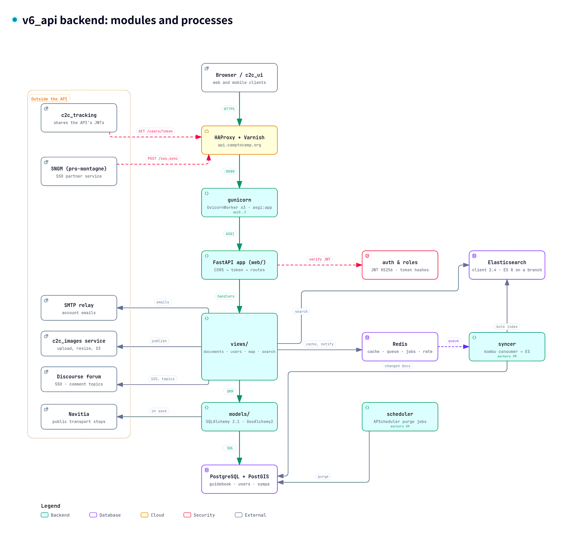
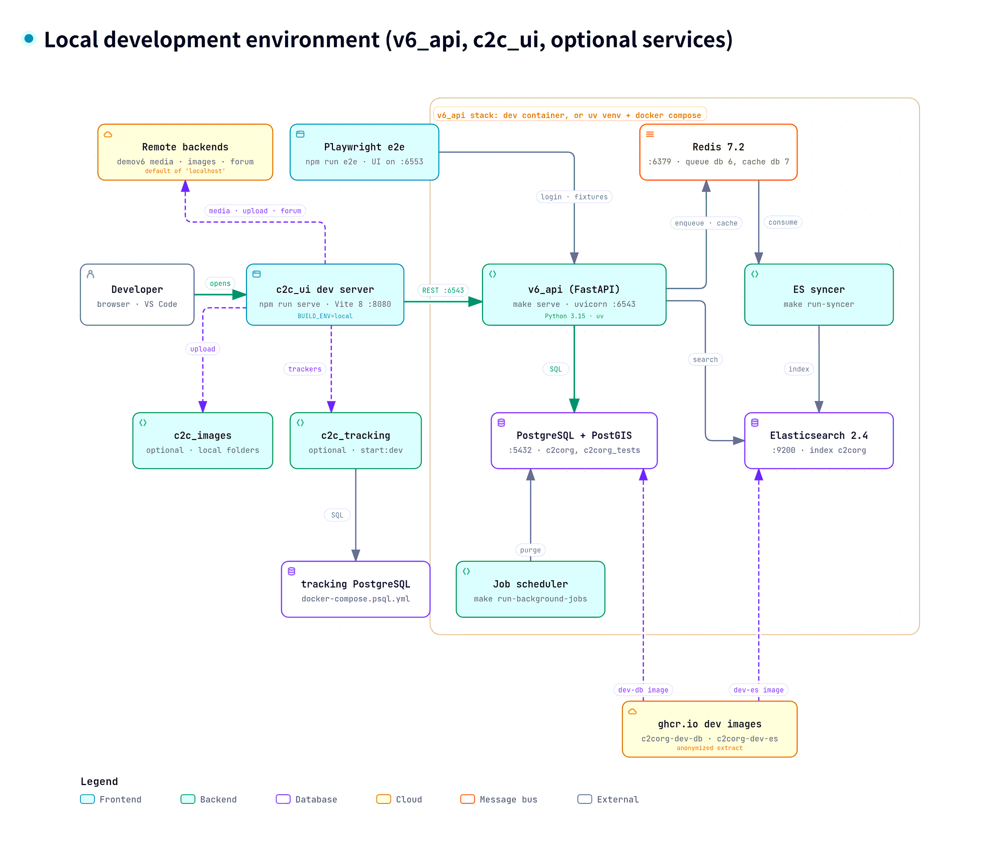
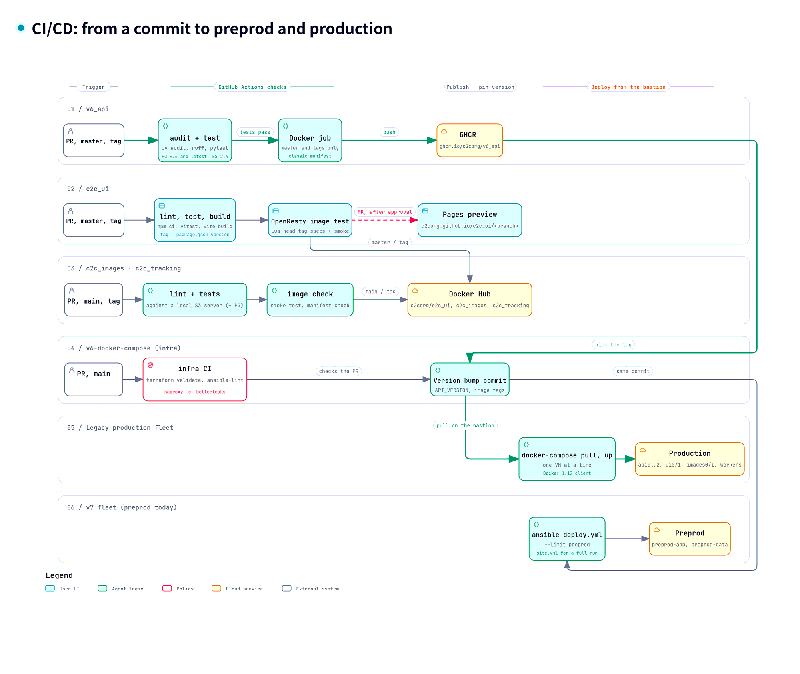

# [camptocamp.org](https://www.camptocamp.org) API

[](https://github.com/c2corg/v6_api/blob/master/LICENSE)


[](https://app.codacy.com/gh/c2corg/v6_api/dashboard)
[](https://snyk.io/test/github/c2corg/v6_api)

## Architecture diagrams

Click a diagram to open its interactive version (zoom, search, details, links to the source code). All the diagrams of camptocamp.org: <https://c2corg.github.io/v6_api/>.

### Backend (v6_api)

[](https://c2corg.github.io/v6_api/architecture/backend.html)

### Local development

[](https://c2corg.github.io/v6_api/architecture/local-dev.html)

### CI/CD

[](https://c2corg.github.io/v6_api/architecture/ci-cd.html)


## Getting started

```sh
git clone https://github.com/c2corg/v6_api
cd v6_api
```

The recommended way to develop is to use the **Dev Container** — see [HOWTO-DEV.md](HOWTO-DEV.md) for full instructions (dev container setup, manual setup, running the API, tests, and linting).

For documentation on the "Mobilité douce" (public transport) features, see [SMART-ORIGIN-README.md](SMART-ORIGIN-README.md).

## Current state of the development stack (November 2026)

| Component     | `master` (this branch)                                                                 | Work in progress |
|---------------|----------------------------------------------------------------------------------------|------------------|
| Python        | 3.15, dependencies managed with uv                                                     | |
| Web framework | FastAPI, served by uvicorn                                                             | |
| PostgreSQL    | Dev: PostgreSQL 18 + PostGIS 3.6, image `ghcr.io/c2corg/c2corg-dev-db` (anonymized extract) | Production servers to PostgreSQL 18 + PostGIS 3.6: branch `pg18-postgis36-migration` of the infra repository |
| Elasticsearch | **2.4** (+ `analysis-icu`), dev image `ghcr.io/c2corg/c2corg-dev-es` with the index built | **8.19**: branch [`feat/elasticsearch-8`](https://github.com/c2corg/v6_api/tree/feat/elasticsearch-8), not merged |
| Redis         | 7.2                                                                                    | |

**One source for the dev services.** The dev container (`.devcontainer/docker-compose.yml`) and the manual setup
(`docker-compose.yml`) use the same two images, published together with the same tag by
[`scripts/dev-database/publish.sh`](scripts/dev-database/README.md). Changing the version of PostgreSQL or
Elasticsearch is done there (`scripts/dev-database/Dockerfile*`), followed by a new publication: both setups then
follow, with no Dockerfile of their own. Until the Elasticsearch 8 images are published, `feat/elasticsearch-8` has
to build its index locally (`make init-elastic`).

## Useful links

- [Developer manual (HOWTO-DEV.md)](HOWTO-DEV.md)
- [Dev Container details (.devcontainer/README.md)](.devcontainer/README.md)
- [Wiki — Development environment](https://github.com/c2corg/v6_api/wiki/Development-environment-on-Linux)
