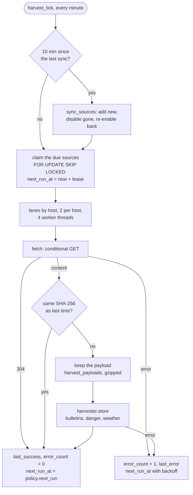

# Harvesting (avalanche bulletins, partner outings)

The scheduler (`make run-background-jobs`, `c2corg_api/scripts/jobs/scheduler.py`) fetches data from outside services
in the background and stores it in PostgreSQL, so that the API reads it from the database instead of asking the
services at each request. The first data harvested are the avalanche bulletins: the BRA of Météo-France (one per French
massif) and the CAAML v6 files of the EAWS services of the Alps and the Pyrenees (SLF, avalanche.report,
lawinen-warnung.eu, AINEVA, Lauegi...). The outings of the partner sites (skitour.fr, gulliver.it...) are harvested
the same way: see [partner-outings.md](partner-outings.md) and [Partner outings](#partner-outings) below.

The code is in two parts:

- `c2corg_api/harvest/`: the generic part. `harvester.py` (what a harvester is), `policy.py` (when to fetch a source
  again), `runner.py` (the tick, the claims, the errors, the health status).
- `c2corg_api/avalanche_bulletins/`: the avalanche harvesters (`harvesters.py`), the requests and parsing shared with
  the on-demand fetch (`meteofrance.py`, `caaml.py`), the storage (`store.py`, `weather.py`) and the read path
  (`regions.py`, `cache.py`, routes in `c2corg_api/web/avalanche_bulletins.py`).

The tables are created by the migration `5e3c1a7b9d42` (`alembic_migration/versions/`). See the
[background jobs diagram](https://c2corg.github.io/v6_api/architecture/batch.html) (the scheduler, the harvest tick, the
harvesters and where a new one plugs in) and the
[backend diagram](https://c2corg.github.io/v6_api/architecture/backend.html).

## Scheduling

A **harvester** has **sources** (`avalanche.meteofrance:FR-03`, `avalanche.caaml:CH:fr`): one URL each, fetched and
stored on its own. Each source is a row of `harvest_sources`, whose `next_run_at` says when it is due.

The scheduler runs `harvest_tick` **every minute** (APScheduler, `max_instances=1`, `coalesce`: a tick still running
makes the next one wait). A tick:

1. every 10 minutes, **syncs** the sources: the sources a harvester lists and the table lacks are added (due now);
   those it no longer lists are disabled (`disabled_at`); a disabled source listed again comes back with its state.
2. **claims** the due sources (`next_run_at <= now`, not disabled, oldest first), with `SELECT ... FOR UPDATE SKIP
   LOCKED`: a source claimed by another scheduler is left to it. Claiming moves `next_run_at` 10 minutes later (the
   lease): a run that dies (crash, restart) is retried after it. At most 60 sources a tick, and at most
   `requests_per_minute` for a harvester with a quota.
3. fetches them in 4 threads, in **lanes by host**: at most 2 lanes for a host, each lane run in turn by a worker, so a
   service never gets more than 2 requests at once, and a slow service does not hold the others.
4. for each source, sends a **conditional GET** (`If-None-Match`, `If-Modified-Since`). A 304, or a content with the
   same SHA-256 as last time, stores nothing. A new content is kept as a payload, then stored by the harvester.
5. records the result and the next `next_run_at`, computed by `policy.next_run`.



### The policy

Each harvester has a `Policy` (`harvest/policy.py`); the avalanche harvesters share `AVALANCHE_POLICY`:

- **Season**: from November 1st to June 30th. Out of season, one check a day, at the start of the first window.
- **Windows**: the times the services publish, Paris time: 07:00-10:00 and 15:30-19:00, a fetch every 15 minutes.
  Outside the windows, every 60 minutes (`default_every`), and never past the start of the next window.
- **After a publication**: once a window saw a new publication (`last_publication`), an update is still possible but
  rarer: every 60 minutes until the window ends (`after_publication_every`).
- **Backoff**: after errors, 15 minutes, doubled at each error up to 4 hours. An error never brings the next fetch
  closer than the schedule would.
- **Jitter**: up to 60 seconds added, to spread the fetches.

`requests_per_minute` bounds the sources a tick claims for a harvester: 40 for Météo-France, whose key allows 50
requests a minute, shared with the PDFs the API fetches on demand. The CAAML services have no quota.

### Switching it on

- `harvest.enabled` (`common.ini.in`, from `harvest_enabled` in `config/env.default`, `false` by default) switches on
  all the harvesters; `harvest.<name>.enabled` (`harvest.avalanche.meteofrance.enabled` from
  `harvest_meteofrance_enabled`, `harvest.avalanche.caaml.enabled` from `harvest_caaml_enabled`) overrides it for one
  harvester: `true` or `false`, empty (the default) to follow `harvest.enabled`. The most specific switch set wins:
  for `partners.skitour`, `harvest.partners.skitour.enabled`, else `harvest.partners.enabled` (a group), else
  `harvest.enabled`. `config/env.default` sets `harvest.partners.enabled` to `true` (`false` in `env.test`): the
  partner sources run whatever `harvest.enabled`, unless switched off. Set them in an env file
  (`config/env.local`, or the one given with `make CONFIG=... load-env`), then `make load-env`.
- With no harvester switched on, the scheduler registers none of the harvest jobs (tick, pruning, compaction).
- Without `METEOFRANCE_API_KEY`, the Météo-France harvester lists no source: its sources get disabled.

## State and health

`harvest_sources`, one row by source:

| Column | |
| --- | --- |
| `id`, `harvester` | `avalanche.caaml:CH:fr`, `avalanche.caaml` |
| `next_run_at` | when it is due (indexed) |
| `last_attempt`, `last_success` | the last claim, the last fetch that went through |
| `last_change`, `last_publication` | the last new content, the last one holding a new publication |
| `error_count`, `last_error` | the errors in a row (0 after a success), the last one (1000 characters) |
| `etag`, `last_modified`, `content_sha256` | for the conditional GET, and to skip a content seen last time |
| `state` | JSONB a harvester keeps between two fetches (`Stored.state`) |
| `disabled_at` | no longer listed by its harvester: not fetched |

A disabled source is deleted 30 days later, with its payloads; its bulletins stay (`source_id` set to null).

`GET /health` has a `harvest` section: by harvester, its enabled `sources`, those `failing` (`error_count > 0`) and the
latest `last_success`. A failing source does not fail the health check (the last data is still read); `harvest` is
`null` if the query fails, `{}` while nothing is harvested.

## Raw payloads

Each new content of a source is kept gzipped in `harvest_payloads`, for debugging and to parse the history again: only
when it changed, once per content (a content seen again moves its `fetched_at`). `prune_harvest`, at 02:00, deletes the
payloads older than `Harvester.keep_payloads_days` (30 days; 0 keeps none).

## Avalanche storage

- **`avalanche_bulletins`**: the bulletins as published (CAAML v6 JSON, normalized as on demand), one row by
  publication and language (`provider`, `bulletin_id`, `lang`, `publication_time`). A publication changed by its service
  without a new time is updated in place. `main_date` is the day the bulletin is valid for; `region_keys` holds its
  regions and all the regions holding them (`AT-07-14-01`: `AT-07-14`, `AT-07`, `AT`), GIN-indexed, to find the
  bulletins of a region at any level.
- **`avalanche_bulletin_regions`**: the danger of each region on each day, from its latest publication of the day: the
  maximum rating (1-5), the ratings below and above the elevation bound, all the bands, the problems and the aspects.
  A few hundred rows a day, **kept forever** for the history of the danger.
- **Superseded publications**: a publication whose regions are all in a later publication of the same provider,
  language and day is deleted after **7 days** (`prune_harvest`, 02:00).
- **Compaction**: the 1st of each month at 03:00, `compact_avalanche_bulletins` removes the bulky `customData` of the
  bulletins whose day is more than **18 months** old, and sets `compacted_at` (a partial index finds the others; a
  batch of 500 is committed at a time). Only the paths of `store.COMPACTED` go: `customData.MeteoFrance.weather`,
  `snowCover`, `newSnow` and `history` (the numbers and series), `customData.CH.aggregation`, `dangerRatingEvolution`
  and `weather`. The texts stay, with the ratings, problems, regions and times: the texts of Météo-France are in
  `customData.MeteoFrance` (`headline`, `dangerComment`, `naturalAvalanches`, `triggeredAvalanches`,
  `avalancheProneLocation`...), as `customData.ALBINA.mainDate`, the `dangerPatterns` of the Euregio and the
  `customData` of the ratings and tendencies (`maxDangerRating`). `avalanche_bulletin_regions` is untouched.
- **SLF weather**: SLF sends the weather of each micro-region (`customData.CH.weather`: 13 of the 17 kB of a
  bulletin), the same in every language. It is stored apart, and answered with the bulletins neither from the database
  nor on demand: `region_weather_hours` (temperature and snowfall limit by hour) and `region_weather_periods` (wind and
  new snow by day). The latest publication wins, a forecast hour becoming an observed one; a correction at the same
  publication time too; the other languages, the same, write nothing. `weather.weather()` reads it (no route yet).

## Read path and caching

| Route | Reads |
| --- | --- |
| `GET /avalanche-bulletins/regions/{region_id}/latest` | the stored bulletins of the latest day still valid (at most 3 days ago), else on demand |
| `GET /avalanche-bulletins/regions/{region_id}/latest/pdf` | the PDF of Météo-France, always on demand |
| `GET /avalanche-bulletins/regions/{region_id}/{date}` | the stored bulletins of a day (`YYYY-MM-DD`, else 400), 404 without |
| `GET /avalanche-bulletins/regions/{region_id}/ratings?from&to` | the danger by day from `avalanche_bulletin_regions` (7 days by default, a year at most) |

- **Stored bulletins** go through Redis (`cache_avalanche_bulletin`) under a key holding a version of the region and
  day (`store.version`: the rows, the last id, the last `updated_at`, set at each insert and change): a new
  publication, a correction at the same time or a pruning changes the key at once. Kept 10 minutes for a day not
  over, without expiry for a day over (answered with `Cache-Control: immutable`, a week).
- **Ratings** too, keyed by region, period and `store.ratings_version` (the rows and the last `updated_at` of
  `avalanche_bulletin_regions`): without expiry for a period over, 10 minutes otherwise.
- **On demand**: a region with nothing stored still valid (not harvested yet, harvest off, the next bulletin not
  harvested yet) or a database error falls back to the services, as before the harvester, cached in Redis 10 minutes
  around the publications and an hour otherwise; the last copy is answered while the service fails. The database
  session is ended before: a slow service holds no connection. The answer has the shape of the stored one (without
  the weather of SLF), and a region holds its sub-regions the same way (`store.region_keys`: `CH-4` holds
  `CH-4231`).
- The language asked, else English, else the one published, by provider.

## Adding a harvester

The *Next harvester*, *Next service* and *Next tables* boxes of the
[background jobs diagram](https://c2corg.github.io/v6_api/architecture/batch.html) show where it plugs in.

1. Subclass `Harvester` (`c2corg_api/harvest/harvester.py`) with a `name`, a `policy`, `sources()`, `url()`,
   `fetch()` and `store()`; set `requests_per_minute` if the service has a quota and `keep_payloads_days`.
2. `store()` writes with the session it is given, never `DBSession`: the runner commits it with the state of the source,
   or rolls both back. Return `Stored(published=True)` when there was a new publication (it slows the polling down).
3. Add it to `runner.harvesters(settings)` (`settings`: the .ini settings, for a harvester configured by them).
4. Add its tables to `c2corg_api/models/` (imported by `models/__init__.py`) and an alembic migration.
5. Add `harvest.<name>.enabled = {harvest_<name>_enabled}` to `common.ini.in` and `harvest_<name>_enabled=""` to
   `config/env.default` (empty: as `harvest.enabled`).
6. Test it with a fake service (see `c2corg_api/tests/harvest/`), and add its pruning to a job if its data grows.

```python
import requests

from c2corg_api.harvest.harvester import Harvester, Payload, Stored
from c2corg_api.harvest.policy import Policy

class SnowHeightHarvester(Harvester):
    name = 'snow.stations'
    policy = Policy(default_every=60)
    keep_payloads_days = 7

    def sources(self):
        return ['north', 'south']

    def url(self, source):
        return f'https://example.org/stations/{source}.json'

    def fetch(self, source, state):
        response = requests.get(
            self.url(source), headers=state.conditional_headers(), timeout=(3, 10)
        )
        return Payload.of(response)  # raises NotModified on 304

    def store(self, session, source, payload):
        rows = parse(payload.content)
        new = save_rows(session, rows)  # with `session` only
        return Stored(published=new)
```

## Operations

- `METEOFRANCE_API_KEY` (environment variable): the key of the Météo-France DPBRA API, 50 requests a minute, shared by
  the harvester (40 a tick at most) and the on-demand fetches.
- Errors are logged as warnings (`Harvesting <source> failed`), and kept in `harvest_sources.last_error`.
- To run one tick by hand (the scheduler may run meanwhile: SKIP LOCKED keeps them apart):

  ```sh
  uv run --frozen python - <<'EOF'
  from sqlalchemy import engine_from_config
  from c2corg_api.config import get_appsettings
  from c2corg_api.harvest import runner
  from c2corg_api.models import DBSession

  settings = get_appsettings('development.ini')
  DBSession.configure(bind=engine_from_config(settings, 'sqlalchemy.'))
  runner.harvest_tick({**settings, 'harvest.enabled': 'true'}, workers=1)
  EOF
  ```

  It fetches only the due sources: to fetch some now, `UPDATE guidebook.harvest_sources SET next_run_at = now() WHERE
  harvester = 'avalanche.caaml';` first.

## Partner outings

The partner outings (`c2corg_api/partners/`, [partner-outings.md](partner-outings.md)) were first harvested by an
APScheduler job of their own. They now run on this framework; this section records the comparison and the choices.

| | Avalanche harvester (this framework) | Partner job (before) | Now |
| --- | --- | --- | --- |
| Scheduling | `harvest_tick` every minute, `next_run_at` by source, claims `SKIP LOCKED` with a lease, lanes by host | an interval job running every source in turn | the tick: a harvester `partners.<name>` by adapter, one source (`partners.skitour:outings`) |
| Switches | `harvest.enabled`, `harvest.<name>.enabled` | `partners.enabled`, `partners.sources` | `harvest...enabled`, with groups: `harvest.partners.enabled`, `harvest.partners.<name>.enabled` |
| Backoff | `Policy`: from `backoff_min`, doubled up to `backoff_max` | after 3 failures, 2 x to 16 x the interval | the policy: from the interval up to 16 x (`partners.interval_minutes`) |
| Status, health | `harvest_sources` (errors, last success); `/health` `harvest` | `partner_sources` (`ok`, `degraded`, `blocked`, `down`, `failing`, `disabled`); `/health` `partners` | `/health` `harvest` only; `partner_sources` stays the domain status of `/partner-outings/sources` (API unchanged) |
| State | `harvest_sources.state`, ETag, SHA-256; `harvest_payloads` | `partner_sources.cursor`, `partner_lookups` | unchanged: the cursor is committed with the outings; `harvest_payloads` keeps a JSON summary of each run (7 days) |
| Fetching | one URL a source, a conditional GET, `Payload` then `store(session)` | an adapter pages and looks up routes in the database while it fetches | `PartnerHarvester.fetch` runs the whole source (`run_source`) and returns the summary; `store` only reads it |
| HTTP | `requests.get` with a user agent and a timeout; 2 requests at once by host | `partners.transport.HttpTransport`: user agent, delay between requests by host, budget by run, timeouts, `classify` (401/403/429 and challenge pages: blocked; 5xx, timeouts: down) | unchanged for now (follow-up below) |
| Tests | `requests.get` mocked, fixture files for the parsers | `FixtureTransport` (recorded answers, manifests), `RecordingTransport` and the `record`/`shapes` CLI, opt-in live tests | both kept |

Choices:

- **One framework.** The tick, the claims, the lanes, the policy, the switches and the health check are this
  framework's. The partner interval job and its backoff are gone; the purge of the partner rows stays a job of its own,
  scheduled even with the harvest off (it expires the lookup cache; the outings only when a retention is set), with a
  job marking the sources switched off `disabled` when the scheduler starts.
- **Why `fetch` stores.** An adapter makes several requests (pages, route lookups cached in `partner_lookups`) and
  normalises the outings: there is no single content to hash and store later. The partner run keeps its own
  transaction (outings, lookups, cursor and status together); a failed run raises `PartnerRunFailed` (`blocked: HTTP
  403...`, secrets masked) so that the runner counts the error and backs off.
- **The pure adapter contract stays partner-specific.** `HarvestedOuting` and `Adapter.fetch(ctx)` model outings;
  a bulletin is a file fetched with a conditional GET, which `Harvester` already fits. What both could share is the
  transport layer below them.
- **Follow-up: one polite HTTP transport.** Move `HttpResponse`, `classify`, `HttpTransport`, `FixtureTransport` and
  `RecordingTransport` (and `SourceBlocked`/`SourceDown`) from `c2corg_api/partners/transport.py` to
  `c2corg_api/harvest/transport.py`, re-exported by the old module so that the adapters keep their imports; then let
  the avalanche harvesters fetch through it (a `Payload` from an `HttpResponse`, conditional headers passed through)
  and test them on recorded manifests instead of mocks of `requests.get`. A blocked or down service would then be
  told apart in `harvest_sources` too. Not done here: it changes the avalanche code and the imports the adapters
  under development rely on.
